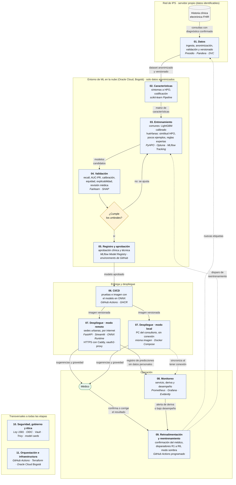

# diagnostico_enfermedades-mlops-U3

Propuesta reestructurada de un pipeline de MLOps end-to-end para predecir, a partir de los síntomas de un paciente, **si es posible que sufra una enfermedad**, tanto **común** (muchos datos) como **huérfana** (pocos datos). Está escrita para que un equipo de ML pueda ponerla en marcha: cada etapa dice qué hace, con qué tecnología, por qué esa y no otra, qué se supone y qué pasa si el supuesto no se cumple.

Es la versión 2.0.0 de la propuesta presentada en la semana 1 del curso. Los cambios están en el [CHANGELOG](CHANGELOG.md).

## La propuesta en una página

- **Para quién.** Una red de 5 IPS en el Valle del Cauca (2 sedes urbanas y 3 rurales), con unos 120 médicos y unas 2.000 consultas al día. El escenario es ficticio, pero sus cifras sirven para dimensionar cada decisión ([docs/00](docs/00-contexto-y-supuestos.md)).
- **Qué responde.** Para cada consulta: si es posible que el paciente tenga una enfermedad, las 5 enfermedades candidatas más probables con su probabilidad, una alerta de sospecha de enfermedad huérfana, el nivel de gravedad con los 5 estados del servicio actual y los síntomas que más pesaron. Es un **apoyo a la decisión**: el médico decide.
- **Dos regímenes de datos, dos ramas de modelado.** Las enfermedades comunes se aprenden de los casos de la red (LightGBM calibrado). Las huérfanas, con muy pocos casos, se detectan comparando los síntomas del paciente con la descripción publicada de cada enfermedad (similitud de fenotipos en HPO), más un clasificador cuando hay al menos 10 casos y reglas de los especialistas.
- **Dos modos de uso, la misma imagen.** Las sedes urbanas usan un **servicio remoto** en la nube; las rurales, con conexión intermitente, corren la solución **en el computador del consultorio** y sincronizan cuando hay internet ([docs/07](docs/07-despliegue.md)).
- **Los datos de los pacientes no salen de la red.** Se anonimizan dentro de ella; a la nube (en Colombia) solo llegan datos anonimizados.
- **Ningún modelo llega al médico sin pasar por una compuerta de calidad** con umbrales fijados de antemano, la aprobación de un médico y de un responsable técnico, un periodo en modo sombra y un despliegue escalonado con vuelta atrás.
- **Madurez objetivo:** nivel 1 de MLOps (entrenamiento continuo automatizado), con camino al nivel 2.

## Diagrama general

**Cómo leer el diagrama.** Cada caja azul es una etapa del pipeline, con su número, lo que hace y, en cursiva, sus tecnologías principales; el número coincide con el de su documento en `docs/`. Los recuadros amarillos agrupan las etapas por dónde corren: el servidor propio de la red de IPS (único lugar con datos que identifican al paciente), el entorno de ML en la nube (solo datos anonimizados), la entrega y despliegue, y la operación. Las flechas continuas son el flujo principal y llevan el nombre de lo que viaja; las punteadas son los ciclos de retroalimentación y la sincronización diferida del modo local. El rombo es la compuerta de calidad: un modelo que no cumple los umbrales vuelve a entrenamiento. Las etapas 10 y 11 son transversales y aplican a todas las demás.

El diagrama también está exportado como imagen en [docs/img/pipeline-general.png](docs/img/pipeline-general.png).

## Etapas y tecnologías

Cada etapa tiene su documento con la misma plantilla de 9 secciones: objetivo, entradas y salidas, proceso, tecnologías con las alternativas descartadas, suposiciones con su implicación, diferencias entre comunes y huérfanas, criterios de salida, riesgos y cambios frente a la propuesta original.

| # | Etapa | Qué resuelve | Tecnologías principales | Por qué, en una línea |
|---|---|---|---|---|
| 00 | [Contexto y supuestos](docs/00-contexto-y-supuestos.md) | Escenario, salida del modelo, 12 supuestos globales y nivel de madurez | | Fija una sola vez lo que todas las etapas dan por hecho |
| 01 | [Datos](docs/01-datos.md) | Exportar, anonimizar, validar y versionar los datos dentro de la red | FHIR `$export`, Presidio, HMAC, Pandera, DVC, Parquet | Estándar de la historia clínica; anonimización medible (*k*-anonimato ≥ 5); contrato de datos como código; versión exacta de los datos de cada modelo |
| 02 | [Características](docs/02-caracteristicas.md) | Llevar síntomas a HPO y construir el vector igual en entrenamiento y en servicio | scikit-learn `Pipeline`, PyHPO | Un solo paquete versionado y una prueba de paridad evitan el desajuste entre entrenamiento y servicio, sin necesidad de un *feature store* |
| 03 | [Entrenamiento](docs/03-entrenamiento.md) | Modelo de comunes, rama de huérfanas y componente de gravedad | LightGBM, regresión logística (línea base), PyHPO, Optuna, MLflow Tracking, ONNX | Árboles potenciados para datos tabulares en CPU; similitud de fenotipos para enfermedades sin casos; cada experimento reproducible |
| 04 | [Validación](docs/04-validacion.md) | Decidir si un modelo es bueno, justo y comprensible | scikit-learn, Fairlearn, SHAP, `umbrales.yaml` | Prueba temporal, validación por sede y *leave-one-out* en huérfanas, con umbrales fijados antes de ver resultados |
| 05 | [Registro y aprobación](docs/05-registro-y-aprobacion.md) | Trazabilidad de cada modelo y aprobación humana | MLflow Model Registry (alias), *environments* de GitHub, *model cards* | Aprobación doble registrada y vuelta atrás moviendo un alias |
| 06 | [CI/CD](docs/06-ci-cd.md) | Probar cada cambio y construir la imagen con el modelo aprobado | GitHub Actions, GitHub Container Registry, Trivy | Ya funciona en la Unidad 2; se agregan pruebas de ML y el disparo por modelo |
| 07 | [Despliegue](docs/07-despliegue.md) | Modo remoto y modo local con la misma imagen | FastAPI, Streamlit, ONNX Runtime, Docker Compose, Caddy, oauth2-proxy, PostgreSQL, SQLite | El servicio de la Unidad 2 evoluciona; el modelo corre en CPU y sin conexión |
| 08 | [Monitoreo](docs/08-monitoreo.md) | Salud del servicio, deriva y desempeño, con una acción por alerta | Prometheus, Grafana, Evidently | La deriva avisa antes de que lleguen los diagnósticos confirmados |
| 09 | [Retroalimentación y reentrenamiento](docs/09-retroalimentacion-y-reentrenamiento.md) | Cerrar el ciclo: correcciones, disparadores R1 a R6 y liberación gradual | GitHub Actions, MLflow, PostgreSQL | Reentrenar con reglas verificables y liberar en modo sombra y por sedes |
| 10 | [Seguridad, gobierno y ética](docs/10-seguridad-gobierno-y-etica.md) | Normas, accesos, secretos, auditoría, gobierno y ética | OIDC con doble factor, HashiCorp Vault, secretos de GitHub, Trivy, BitLocker, *model cards* y *datasheets* | Datos de salud sensibles y un servicio expuesto a internet |
| 11 | [Orquestación e infraestructura](docs/11-orquestacion-e-infraestructura.md) | Dónde corre cada pieza, cómo se encadenan las etapas y cómo se crea la infraestructura | GitHub Actions con *runners* propios, Terraform, Oracle Cloud (región Bogotá), Docker Compose | Datos en Colombia, infraestructura reproducible y sin herramientas de gran escala que el escenario no necesita |

**Lo que no se usa, a propósito.** Spark, Kubernetes, Airflow y un *feature store* no se adoptan en esta versión porque el volumen (unas 2.000 consultas al día, unos pocos millones de filas de historia) cabe en una sola máquina y los flujos son pocos. La [etapa 11](docs/11-orquestacion-e-infraestructura.md#36-lo-que-no-se-usa-al-inicio-y-cuándo-sí) explica cuándo sí convendría cada uno.

## Cómo se cumple cada requisito del enunciado

| Requisito | Dónde se cumple |
|---|---|
| Pipeline end-to-end reestructurado con lo visto en el curso | Diagrama general y etapas 01 a 11 |
| El médico puede correr la solución en su computador o hacer peticiones a un servicio en la nube | [07. Despliegue](docs/07-despliegue.md): modo local y modo remoto con la misma imagen, y regla para elegir |
| Cada etapa con sus tecnologías y la argumentación de cada elección | Sección 4 de cada etapa: tecnología elegida, alternativas, por qué sí y por qué no, costo y operación |
| Explicación detallada y decisiones justificadas | Secciones 1 a 3 y 7 de cada etapa |
| Todas las suposiciones, con sus implicaciones | 12 supuestos globales en [docs/00](docs/00-contexto-y-supuestos.md#4-supuestos-globales) y la sección 5 de cada etapa |
| Nada a interpretación del lector | Contrato de entrada y salida, umbrales numéricos, disparadores R1 a R6, tabla de alertas y acciones, matriz de accesos |
| CHANGELOG frente a la propuesta de la semana 1 | [CHANGELOG.md](CHANGELOG.md) |

## Plan de puesta en marcha

Un equipo que implemente esta propuesta avanzaría por fases, cada una con su criterio para pasar a la siguiente:

| Fase | Alcance | Etapas | Criterio para avanzar |
|---|---|---|---|
| 1. Bases | Infraestructura con Terraform, repositorio con ramas protegidas, *runner* en la red, gobierno y matriz de accesos aprobados | 06, 10, 11 | Staging y producción creados desde el mismo código; responsable de protección de datos de acuerdo con la matriz de accesos |
| 2. Datos | Exportación FHIR, anonimización, validación y primera versión del conjunto | 01, 02 | Una versión publicada con *k* ≥ 5, cero identificadores en la muestra revisada y todas las reglas de calidad en verde |
| 3. Comunes en modo remoto | Modelo de comunes, compuerta de validación y servicio remoto para las sedes urbanas, con la gravedad por reglas | 03, 04, 05, 07, 08 | Umbrales de [04](docs/04-validacion.md) cumplidos y un mes en producción sin alertas de desempeño |
| 4. Huérfanas | Rama de huérfanas con las 20 enfermedades priorizadas, revisada por especialistas | 03, 04, 09 | Todos los casos de referencia de huérfanas detectados y tasa de alertas falsas dentro del umbral |
| 5. Modo local | Instalación en las 3 sedes rurales con sincronización y actualización automática | 07, 08 | Un mes de sincronización sin pérdida de registros |
| 6. Operación continua | Disparadores de reentrenamiento, modo sombra y despliegue escalonado funcionando sin intervención manual | 09, 11 | Un reentrenamiento completo, del disparador a las sedes rurales, ejecutado de punta a punta |

Empezar por las enfermedades comunes en modo remoto pone en marcha toda la infraestructura con el caso que tiene más datos y menos riesgo, como ya proponía la versión original.

## Lo que ya está implementado

La propuesta parte de un servicio real, construido en las unidades anteriores del curso:

- **Servicio en Docker** (Unidad 1 y 2): API en FastAPI, interfaz en Streamlit, 5 estados de gravedad por reglas, registro de predicciones y reporte de estadísticas. Es la base de la [etapa 07](docs/07-despliegue.md): el modelo entrenado reemplaza la función de reglas detrás del mismo contrato.
- **CI/CD con GitHub Actions** (Unidad 2): lint, tipos y 75 pruebas en cada PR, y publicación de las imágenes en GitHub Packages en cada merge a `main`. Es la base de la [etapa 06](docs/06-ci-cd.md).

Repositorio: https://github.com/troyano/diagnostico_enfermedades-mlops-U2

## Contenido del repositorio

| Ruta | Contenido |
|---|---|
| `README.md` | Esta visión general, el diagrama, la tabla de etapas y el plan de puesta en marcha |
| `docs/` | Un documento por etapa, de `00` a `11` |
| `docs/img/` | Diagrama general exportado como imagen |
| `CHANGELOG.md` | Cambios frente a la propuesta de la semana 1 |
| `.github/workflows/docs-check.yml` | Validación automática en cada PR: enlaces internos y externos, y que cada diagrama Mermaid se pueda dibujar |

## Referencias

- Propuesta original del pipeline (Unidad 1, versión `v1.1.0`): https://github.com/troyano/mlops-enfermedades/blob/v1.1.0/docs/brief.md
- Repositorio de ejemplo del curso, pipeline para una Fintech: https://github.com/avila196/mlops-sample
- Niveles de madurez de MLOps (Google Cloud): https://docs.cloud.google.com/architecture/mlops-continuous-delivery-and-automation-pipelines-in-machine-learning?hl=es
- Ley 1392 de 2010, enfermedades huérfanas: https://www.funcionpublica.gov.co/eva/gestornormativo/norma.php?i=39965
- Ley 2015 de 2020, interoperabilidad de la historia clínica electrónica: https://www.funcionpublica.gov.co/eva/gestornormativo/norma.php?i=105472
- Ministerio de Salud, enfermedades huérfanas: https://www.minsalud.gov.co/salud/publica/PENT/paginas/enfermedades-huerfanas.aspx
- MLflow, alias del registro de modelos en lugar de etapas: https://github.com/mlflow/mlflow/issues/10336
- GitHub, *environments* y revisores obligatorios: https://docs.github.com/en/actions/reference/workflows-and-actions/deployments-and-environments
- Oracle Cloud, región de Bogotá: https://docs.oracle.com/iaas/releasenotes/changes/d332ad8f-ad0b-48f8-8577-33da7766ee36
- Human Phenotype Ontology (HPO): https://hpo.jax.org
- Orphanet: https://www.orpha.net

## Contexto académico

Maestría en Inteligencia Artificial Aplicada, Universidad Icesi. Materia: Machine Learning Operations (MLOps), periodo 2026-II.

## Autores

- Eduar Troyano Velásquez
- Alexander Amador
