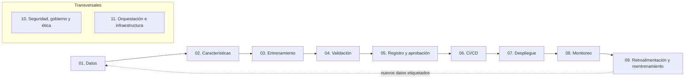

# 00. Contexto y supuestos

[Inicio](../README.md) · [Siguiente: Datos](01-datos.md)

> **Pendiente de redactar.** Este documento fija una sola vez el problema, el escenario, la salida del modelo y los supuestos globales que usan todas las etapas.

## 1. Problema

_El problema del enunciado y qué se espera del sistema._

## 2. Escenario y usuarios

_Quién usa el sistema, dónde y con qué volumen._

## 3. Salida del modelo

_Qué predice el modelo y cómo se muestra al médico._

## 4. Supuestos globales

| # | Suposición | Implicación si deja de cumplirse |
|---|---|---|
| S1 | _Pendiente_ | |

## 5. Nivel de madurez MLOps objetivo

_Nivel de partida y camino de evolución._

## 6. Etapas del pipeline

| # | Etapa | Tecnología principal |
|---|---|---|
| 01 | [Datos](01-datos.md) | _Pendiente_ |
| 02 | [Características](02-caracteristicas.md) | _Pendiente_ |
| 03 | [Entrenamiento](03-entrenamiento.md) | _Pendiente_ |
| 04 | [Validación](04-validacion.md) | _Pendiente_ |
| 05 | [Registro y aprobación](05-registro-y-aprobacion.md) | _Pendiente_ |
| 06 | [CI/CD](06-ci-cd.md) | _Pendiente_ |
| 07 | [Despliegue](07-despliegue.md) | _Pendiente_ |
| 08 | [Monitoreo](08-monitoreo.md) | _Pendiente_ |
| 09 | [Retroalimentación y reentrenamiento](09-retroalimentacion-y-reentrenamiento.md) | _Pendiente_ |
| 10 | [Seguridad, gobierno y ética](10-seguridad-gobierno-y-etica.md) | _Pendiente_ |
| 11 | [Orquestación e infraestructura](11-orquestacion-e-infraestructura.md) | _Pendiente_ |

### Diagrama provisional

Diagrama de referencia para fijar los nombres de las etapas. Se reemplaza por el diagrama general definitivo.

## 7. Cómo leer esta propuesta

_Orden recomendado de lectura y convenciones (plantilla de 9 secciones por etapa, numeración de supuestos)._
