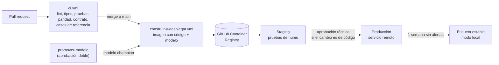

# 06. CI/CD

[Inicio](../README.md) · [Anterior: Registro y aprobación](05-registro-y-aprobacion.md) · [Siguiente: Despliegue](07-despliegue.md)

## 1. Objetivo

Garantizar que **ningún cambio llegue al médico sin pasar por pruebas automáticas**, y convertir cada cambio aprobado (de código o de modelo) en una **imagen de Docker versionada** que se despliega de la misma forma en todos los ambientes.

La etapa existe porque el sistema cambia por dos caminos distintos: cuando el equipo modifica el código (el servicio, el paquete de características, el pipeline) y cuando se aprueba un modelo nuevo ([05. Registro y aprobación](05-registro-y-aprobacion.md)). Los dos tienen que terminar en el mismo lugar: una imagen probada, con versión, lista para [07. Despliegue](07-despliegue.md).

Esta etapa **no parte de cero**: la integración y la entrega continuas del servicio ya funcionan en el [repositorio de la Unidad 2](https://github.com/troyano/diagnostico_enfermedades-mlops-U2), con el flujo [`ci-cd.yml`](https://github.com/troyano/diagnostico_enfermedades-mlops-U2/blob/main/.github/workflows/ci-cd.yml): comentarios en cada PR, lint con Ruff, tipos con mypy, 75 pruebas con pytest y publicación de las imágenes `diagnostico-api` y `diagnostico-ui` en GitHub Packages en cada merge a `main`. Esta propuesta lo extiende con las pruebas propias de ML y con el disparo por modelo.

## 2. Entradas y salidas

| Entrada | Formato | Origen |
|---|---|---|
| Cambio de código | Pull request contra `main` del repositorio del sistema | Equipo de ML |
| Modelo aprobado | Versión de MLflow con alias `champion` | Flujo `promover-modelo` de [05. Registro y aprobación](05-registro-y-aprobacion.md) |
| Casos de referencia y umbrales | Archivos versionados en Git | [04. Validación](04-validacion.md) |

| Salida | Formato | Quién la consume |
|---|---|---|
| Resultado de las pruebas en el PR | Checks de GitHub y comentarios en el PR | Equipo; la protección de `main` exige que pasen |
| Imagen del servicio | Imágenes `diagnostico-api` y `diagnostico-ui` en GitHub Container Registry, con etiquetas `vX.Y.Z-mN` (versión del código y del modelo) y `sha-<commit>` | [07. Despliegue](07-despliegue.md) |
| Despliegue en staging y en producción | Ejecución de los *environments* `staging` y `produccion-servicio` | Servicio remoto y canal de actualización del modo local |

## 3. Proceso

### 3.1 Ambientes

Los ambientes son **lugares donde corre el sistema**, no ramas de Git (en la propuesta original se mezclaban):

| Ambiente | Dónde corre | Para qué |
|---|---|---|
| Desarrollo | Computador de cada integrante y entorno de ML | Programar y experimentar, con datos anonimizados |
| Staging | Una máquina en la nube igual a producción, sin médicos | Probar la imagen completa antes de producción |
| Producción | Servicio remoto y computadores de las sedes rurales | Uso real |

El código sigue el flujo que el equipo ya usa: ramas de trabajo con PR a una rama `main` protegida, que solo acepta cambios con todas las pruebas en verde.

### 3.2 Integración continua (en cada PR)

El flujo `ci.yml` corre en cada PR, en paralelo por componente, y comenta el inicio y el resultado en el PR, como en la Unidad 2:

1. **Calidad de código:** Ruff (lint y formato) y mypy estricto.
2. **Pruebas unitarias** del servicio, de la interfaz y del paquete `diagnostico_features`.
3. **Prueba de paridad de características:** el mismo lote de consultas transformado por la ruta de entrenamiento y por la del servicio da la misma matriz ([02. Características](02-caracteristicas.md)).
4. **Pruebas de los contratos de datos:** los esquemas de Pandera de [01. Datos](01-datos.md) se prueban con datos sintéticos que incluyen errores a propósito, para confirmar que los detectan.
5. **Pruebas del contrato de la API:** la respuesta cumple el formato de [00. Contexto y supuestos](00-contexto-y-supuestos.md) (campos, tipos y los 5 estados).
6. **Pruebas de comportamiento del modelo:** con el modelo `champion` actual descargado del registro, el servicio debe dar el resultado esperado en todos los **casos de referencia** y responder dentro de la latencia límite.

Si cualquier paso falla, el PR no se puede fusionar.

### 3.3 Entrega continua (construcción y despliegue)

Un flujo reutilizable, `construir-y-desplegar.yml`, hace siempre lo mismo, venga de donde venga el cambio:

1. Descarga el modelo con alias `champion` desde el registro de MLflow (archivo ONNX, umbrales y reglas).
2. Construye las imágenes con el código del commit y ese modelo dentro, y las publica en GitHub Container Registry con su etiqueta de versión.
3. Despliega en **staging** y corre las **pruebas de humo**: salud del servicio, una predicción por cada caso de referencia y verificación de que la versión del modelo que responde es la esperada.
4. Despliega en **producción** (*environment* `produccion-servicio`): actualiza el servicio remoto. La etiqueta `estable`, que usan las sedes en modo local ([07. Despliegue](07-despliegue.md)), se mueve una semana después si no hubo alertas: es el despliegue escalonado de [09. Retroalimentación y reentrenamiento](09-retroalimentacion-y-reentrenamiento.md).

Lo que cambia es quién lo dispara y qué aprobación pide:

| Disparo | Cuándo | Aprobación para producción |
|---|---|---|
| Cambio de código | Merge a `main` | El responsable técnico aprueba en el *environment* `produccion-servicio` |
| Modelo nuevo | El flujo `promover-modelo` lo llama al terminar, con la versión aprobada | Ninguna adicional: el modelo ya tuvo la aprobación doble en [05. Registro y aprobación](05-registro-y-aprobacion.md) |
| Vuelta atrás | `promover-modelo` mueve `champion` a la versión `anterior` | La misma de la vuelta atrás en [05. Registro y aprobación](05-registro-y-aprobacion.md) |

## 4. Tecnologías

| Necesidad | Tecnología elegida | Alternativas consideradas | Por qué sí y por qué no | Costo y operación |
|---|---|---|---|---|
| Ejecutar CI y CD | **GitHub Actions** | Jenkins; GitLab CI | Ya está implementado y probado en la Unidad 2, vive junto al código y a la protección de ramas. Jenkins exige un servidor propio que mantener; GitLab obligaría a mudar el repositorio | Gratis en repositorios públicos; minutos incluidos en planes privados |
| Registro de imágenes | **GitHub Container Registry** (GHCR) | Docker Hub; registro de un proveedor de nube | Ya se usa en la Unidad 2, comparte permisos con el repositorio y se autentica con el token del flujo. Docker Hub limita descargas anónimas; un registro de nube ata al proveedor | Incluido en GitHub; almacenamiento según el plan |
| Aprobación de despliegues | ***Environments* de GitHub** (`staging`, `produccion-servicio`) | Aprobación fuera de GitHub | Mismo mecanismo que la aprobación de modelos; deja registro de quién aprobó | Ver S05.2 sobre repositorios privados |
| Reutilizar la construcción | **Flujo reutilizable** (`workflow_call`) | Copiar los pasos en cada flujo | Un solo flujo de construcción evita que la imagen se arme distinto según el disparo | Sin costo |
| Reportes de métricas en el PR | No se adopta al inicio | CML (Continuous Machine Learning) | CML publica gráficos de métricas en los PR; es útil cuando se entrena en cada PR. Aquí el entrenamiento no ocurre en el PR sino en [03. Entrenamiento](03-entrenamiento.md), y su reporte ya queda en MLflow | |

## 5. Suposiciones

| # | Suposición | Implicación si deja de cumplirse |
|---|---|---|
| S06.1 | El flujo de CI puede leer el registro de MLflow (credencial de solo lectura guardada como secreto del repositorio) | Sin acceso, las pruebas de comportamiento se hacen con un modelo de prueba versionado en el repositorio, y la verificación con el `champion` real pasa a staging |
| S06.2 | La suite completa de CI tarda menos de 10 minutos | Si crece, las pruebas lentas (casos de referencia) se separan para correr solo en `main` y en staging |
| S06.3 | Hay una máquina de staging equivalente a producción | Sin staging, las pruebas de humo corren en producción antes de abrir el tráfico, con más riesgo |
| S06.4 | La imagen con el modelo incluido pesa menos de 1 GB (G5) | Si el modelo crece, la imagen se separa: el servicio descarga el modelo al arrancar, a costa de depender de la red en el modo local |

## 6. Enfermedades comunes y huérfanas

| Aspecto | Comunes (muchos datos) | Huérfanas (pocos datos) |
|---|---|---|
| Pruebas de comportamiento | Casos de referencia de las clases comunes y de cada estado de gravedad | **Un caso de referencia por cada huérfana priorizada**: si el servicio deja de activar la alerta en uno de ellos, el cambio no pasa |
| Qué viaja en la imagen | Modelo ONNX y umbrales | Parámetros de similitud, calibraciones, clasificadores y reglas expertas en YAML. Las reglas se prueban como código |

## 7. Criterios de salida y controles de calidad

- Todos los checks de `ci.yml` en verde antes de fusionar a `main` (exigido por la protección de la rama).
- Imagen publicada con etiqueta de versión de código y de modelo.
- Pruebas de humo en staging en verde antes de producción.
- La versión del modelo que responde en producción coincide con el alias `champion`.

## 8. Riesgos

| Riesgo | Mitigación |
|---|---|
| Un cambio de código rompe el comportamiento clínico sin que fallen las pruebas unitarias | Pruebas de comportamiento con casos de referencia y prueba de paridad en cada PR |
| Imagen construida con un modelo distinto del aprobado | El flujo solo descarga el alias `champion`; la prueba de humo verifica la versión que responde |
| Secretos expuestos en los registros del flujo | Secretos de GitHub con permisos mínimos por flujo, como en la Unidad 2 ([10. Seguridad, gobierno y ética](10-seguridad-gobierno-y-etica.md)) |
| Despliegue roto en producción | Staging idéntico y vuelta atrás a la imagen anterior, que sigue publicada en el registro |

## 9. Cambios respecto a la propuesta original

| Antes (propuesta original) | Ahora | Motivo |
|---|---|---|
| CI/CD descrito en teoría: pruebas en cada cambio y construcción de imagen al promover un modelo | Implementado en la Unidad 2 y extendido con pruebas de ML (paridad, contratos de datos, comportamiento con casos de referencia) | La teoría ya es código que funciona |
| Ambientes de desarrollo, staging y producción asociados a ramas (`dev`, `stage`, `main`) | Ambientes como lugares de ejecución; el código usa ramas de trabajo con PR a `main` protegida | Una rama no es un ambiente: mezclar ambos complicaba el flujo, como se vio en la Unidad 1 |
| El CD solo se disparaba al promover un modelo | Dos disparadores (código y modelo) que terminan en el mismo flujo de construcción | Los cambios de código también tienen que llegar a producción de forma controlada |
| Sin pruebas de humo ni verificación de la versión desplegada | Pruebas de humo en staging y verificación de la versión del modelo | Confirmar que lo desplegado es lo aprobado |
