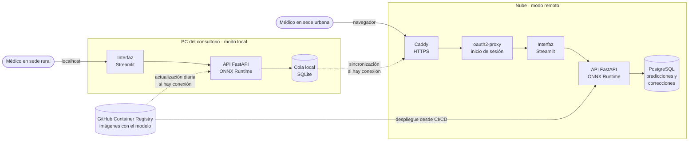

# 07. Despliegue

[Inicio](../README.md) · [Anterior: CI/CD](06-ci-cd.md) · [Siguiente: Monitoreo](08-monitoreo.md)

## 1. Objetivo

Poner el modelo al alcance del médico de **dos formas**, como pide el enunciado:

- **Modo remoto:** el médico usa el sistema desde el navegador y las peticiones van a un servicio alojado en la nube.
- **Modo local:** el médico corre la solución en el computador del consultorio, sin depender de internet.

Los dos modos usan **la misma imagen de Docker**, con el mismo código, el mismo modelo y el mismo contrato de API. Solo cambia dónde corre y cómo se actualiza.

## 2. Entradas y salidas

| Entrada | Formato | Origen |
|---|---|---|
| Imágenes `diagnostico-api` y `diagnostico-ui` con el modelo incluido | Imágenes en GitHub Container Registry, etiquetas `vX.Y.Z-mN` y `estable` | [06. CI/CD](06-ci-cd.md) |
| Consulta del médico | Formulario de la interfaz o JSON del contrato de entrada | Médico |

| Salida | Formato | Quién la consume |
|---|---|---|
| Resultado para el médico | Respuesta JSON del contrato de salida, mostrada en la interfaz | Médico |
| Registro de predicciones | Una línea por predicción, sin datos personales: `id_consulta`, fecha, sede, versión del modelo, entradas codificadas, candidatos, alerta, estado y latencia | [08. Monitoreo](08-monitoreo.md) |
| Correcciones del médico | Registro con `id_consulta`, versión del modelo y diagnóstico corregido | [09. Retroalimentación y reentrenamiento](09-retroalimentacion-y-reentrenamiento.md) |
| Métricas del servicio | Punto final `/metrics` en formato Prometheus | Monitoreo |

## 3. Proceso

### 3.1 Qué hay dentro de la imagen

El servicio es la evolución del que ya existe en la [Unidad 2](https://github.com/troyano/diagnostico_enfermedades-mlops-U2): una API en **FastAPI** y una interfaz en **Streamlit**, cada una en su contenedor. Cambia lo siguiente:

- La función de reglas `predecir()` se reemplaza por el **modelo**: el paquete `diagnostico_features` transforma la consulta, **ONNX Runtime** ejecuta el modelo de comunes, la rama de huérfanas calcula similitudes y reglas, y el componente de gravedad devuelve el estado.
- La API mantiene `GET /health`, `POST /predecir`, `GET /consultas` y `GET /estadisticas`, y agrega `GET /metrics` (Prometheus) y `POST /retroalimentacion` (correcciones del médico).
- La interfaz muestra los candidatos con su probabilidad, la alerta de huérfana, el estado y los síntomas que más pesaron, y agrega los botones **Confirmar** y **Corregir diagnóstico**.
- Si el modelo no carga, el servicio responde solo con el estado de gravedad por reglas y lo indica en pantalla (respaldo descrito en [00. Contexto y supuestos](00-contexto-y-supuestos.md)).

### 3.2 Modo remoto (sedes urbanas)

1. Una **máquina virtual en la nube** (proveedor definido en [11. Orquestación e infraestructura](11-orquestacion-e-infraestructura.md)) corre los contenedores con **Docker Compose**, igual que en la Unidad 2, más dos piezas delante:
   - **Caddy** como proxy inverso, con **HTTPS automático**: todo el tráfico va cifrado.
   - **oauth2-proxy**, que exige iniciar sesión con la cuenta institucional del médico (proveedor de identidad de la red, por OpenID Connect) antes de ver la interfaz o llamar a la API.
2. El médico abre la dirección del servicio en el navegador del consultorio, inicia sesión y usa la interfaz. Nada se instala en su computador.
3. Las predicciones y correcciones se guardan en una base **PostgreSQL** administrada, en lugar del archivo JSON de la Unidad 2, para que varias sedes escriban a la vez sin conflictos.
4. La actualización la hace el flujo de [06. CI/CD](06-ci-cd.md): baja la imagen nueva y reinicia los contenedores, primero en staging y después en producción.

### 3.3 Modo local (sedes rurales)

1. El computador del consultorio tiene **Docker Desktop** y un `docker-compose.yml` de la red con las dos imágenes (G5). La interfaz se abre en `localhost`, como en la Unidad 2.
2. El servicio funciona **sin conexión**: el modelo está dentro de la imagen y no consulta nada externo para predecir.
3. Las predicciones y correcciones se guardan en una **cola local** (un archivo SQLite en un volumen de Docker). Cuando hay conexión, un proceso de sincronización las envía al servicio central por HTTPS, con un token de la sede, y las marca como enviadas.
4. **Actualización:** una tarea programada del sistema operativo revisa una vez al día si la etiqueta `estable` cambió en el registro; si cambió y hay conexión, descarga la imagen nueva y reinicia los contenedores fuera del horario de consulta. Si no hay conexión, sigue con la versión que tiene.
5. Una versión local con más de 30 días de atraso muestra un aviso al médico y se reporta al equipo cuando sincroniza.

### 3.4 Regla para elegir el modo

| Condición de la sede | Modo |
|---|---|
| Conexión estable (disponible al menos el 99 % del horario de consulta) | **Remoto** |
| Conexión intermitente o sin conexión | **Local** |
| Computador sin los recursos de G5 (4 núcleos, 8 GB de RAM) | **Remoto** obligatorio; si además la conexión es mala, se cambia el equipo |
| Contingencia: el servicio remoto no responde | La sede urbana puede usar una instalación local de respaldo, preparada de antemano |

El modelo actual cabe en los dos modos: responde en CPU en menos de 500 ms y la imagen pesa menos de 1 GB ([04. Validación](04-validacion.md)). Si una versión futura dejara de cumplirlo (por ejemplo, un modelo que necesite GPU), solo el modo remoto la ofrecería y el modo local seguiría con la última versión compatible.

## 4. Tecnologías

| Necesidad | Tecnología elegida | Alternativas consideradas | Por qué sí y por qué no | Costo y operación |
|---|---|---|---|---|
| API y interfaz | **FastAPI** y **Streamlit** | Flask; una aplicación web a la medida | Ya están construidas y probadas en las Unidades 1 y 2; FastAPI valida el contrato con Pydantic y genera la documentación. Rehacerlas no aporta | Sin licencias |
| Ejecutar el modelo | **ONNX Runtime** en CPU | LightGBM nativo; un servidor de modelos (por ejemplo, Triton) | ONNX Runtime es liviano, rápido en CPU y no depende de la biblioteca de entrenamiento. Un servidor de modelos dedicado sobra para 2.000 consultas al día (G10) y complica el modo local | Sin licencias |
| Empaquetar y correr | **Docker** y **Docker Compose** | Instalador nativo; Kubernetes | La misma imagen corre en la nube y en el consultorio, y el equipo ya la usa desde la Unidad 1. Un instalador nativo duplicaría el trabajo por sistema operativo; Kubernetes sobra para un nodo (G6, G10) | Sin licencias. Docker Desktop puede requerir licencia según el tamaño de la organización (ver S07.4) |
| HTTPS | **Caddy** | Nginx con Certbot; balanceador del proveedor | Caddy obtiene y renueva certificados solo, con una configuración de pocas líneas. Nginx necesita configurar la renovación aparte | Sin licencias |
| Autenticación | **oauth2-proxy** con el proveedor de identidad de la red (OpenID Connect) | Usuarios y contraseñas propios en la aplicación | Los médicos usan su cuenta institucional y la red controla altas y bajas en un solo lugar. Gestionar contraseñas propias agrega riesgo y trabajo | Sin licencias |
| Persistencia en modo remoto | **PostgreSQL** administrado | El archivo JSON de la Unidad 2 | Varias sedes escriben a la vez; un archivo con bloqueo funciona para un solo consultorio, no para cinco sedes | Pago mensual pequeño por la base administrada |
| Cola en modo local | **SQLite** | Archivo JSON | SQLite es transaccional y no se corrompe si se apaga el equipo a mitad de una escritura | Sin costo |

## 5. Suposiciones

| # | Suposición | Implicación si deja de cumplirse |
|---|---|---|
| S07.1 | La red tiene un proveedor de identidad compatible con OpenID Connect (por ejemplo, el de su correo institucional) | Sin él, se usa un proveedor de identidad administrado por el equipo, con más trabajo de altas y bajas |
| S07.2 | Las sedes rurales tienen conexión al menos unas horas por semana | Si una sede pasa semanas sin conexión, la actualización y la sincronización se hacen con una memoria USB cifrada, con un procedimiento documentado |
| S07.3 | El área de TI puede instalar Docker Desktop y la tarea programada en los computadores de las sedes rurales | Sin permisos de instalación, la sede pasa a modo remoto cuando tenga conexión, o se usa un equipo dedicado administrado por TI |
| S07.4 | La licencia de Docker Desktop es viable para la red | Si no lo es, se usa una alternativa compatible (por ejemplo, Rancher Desktop o Podman) que ejecuta las mismas imágenes |
| S07.5 | Una sola máquina virtual atiende el modo remoto con holgura (G10) | Con mucho más volumen, se agregan réplicas detrás de un balanceador; la imagen no cambia |

## 6. Enfermedades comunes y huérfanas

| Aspecto | Comunes (muchos datos) | Huérfanas (pocos datos) |
|---|---|---|
| Qué ve el médico | Candidatos con su probabilidad | Un **aviso destacado**, "sospecha de enfermedad huérfana, remitir a especialista", con la enfermedad y los síntomas que la sugieren |
| Acción esperada | Usar la sugerencia como apoyo | Remitir al especialista de referencia; la remisión queda registrada como retroalimentación |
| Cobertura | Las 30 agrupaciones del modelo | Solo las huérfanas priorizadas; la interfaz lo dice, para que el médico no asuma que una huérfana fuera de la lista quedó descartada |

## 7. Criterios de salida y controles de calidad

- `GET /health` responde en los dos modos después de cada despliegue.
- La versión del modelo que muestra la respuesta coincide con el alias `champion` (modo remoto) o con la etiqueta `estable` descargada (modo local).
- Latencia del percentil 95 por debajo de 500 ms en producción.
- El modo local funciona con la conexión desactivada (prueba incluida en las pruebas de humo de la imagen).
- Ninguna línea del registro de predicciones contiene nombre ni documento.

## 8. Riesgos

| Riesgo | Mitigación |
|---|---|
| Sedes rurales con versiones viejas del modelo | Actualización diaria automática, aviso a los 30 días y reporte al sincronizar |
| Pérdida de predicciones o correcciones en el modo local | Cola SQLite transaccional; solo se marcan como enviadas cuando el servidor confirma |
| Acceso no autorizado al servicio remoto | HTTPS obligatorio, inicio de sesión institucional y registro de accesos ([10. Seguridad, gobierno y ética](10-seguridad-gobierno-y-etica.md)) |
| Caída del servicio remoto en horario de consulta | Salud monitoreada ([08. Monitoreo](08-monitoreo.md)), reinicio automático de contenedores e instalación local de respaldo |

## 9. Cambios respecto a la propuesta original

| Antes (propuesta original) | Ahora | Motivo |
|---|---|---|
| Un solo modo: contenedor que el médico ejecuta "en su propio sistema" | Modo remoto y modo local con la misma imagen, y una regla para elegir según conexión y recursos | Lo exige el enunciado y lo justifica el escenario (G12) |
| ONNX como formato "opcional" | ONNX Runtime es la forma de ejecutar el modelo en los dos modos | Permite que el modo local corra en CPU con una imagen liviana (G5) |
| Sin seguridad del servicio | HTTPS con Caddy, inicio de sesión con oauth2-proxy y el proveedor de identidad de la red | El modo remoto expone el servicio en internet |
| Persistencia no definida (en la Unidad 2, un archivo JSON) | PostgreSQL en el modo remoto y cola SQLite con sincronización en el modo local | Varias sedes y trabajo sin conexión |
| Sin mecanismo de actualización | CI/CD en el modo remoto y actualización diaria por etiqueta `estable` en el modo local | Que todas las sedes usen el modelo aprobado |
