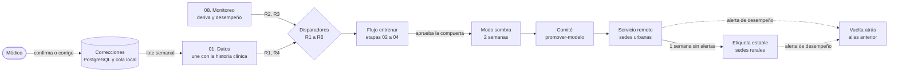

# 09. Retroalimentación y reentrenamiento

[Inicio](../README.md) · [Anterior: Monitoreo](08-monitoreo.md) · [Siguiente: Seguridad, gobierno y ética](10-seguridad-gobierno-y-etica.md)

## 1. Objetivo

Cerrar el ciclo del pipeline: **convertir lo que pasa en la consulta en datos nuevos**, decidir **cuándo** vale la pena reentrenar con reglas verificables y **liberar** el modelo nuevo de forma gradual, con la posibilidad de volver atrás.

La etapa existe porque un modelo clínico envejece: cambian las poblaciones, aparecen casos nuevos de huérfanas y los médicos corrigen errores. Sin esta etapa, el sistema se quedaría con lo que aprendió el primer día, y reentrenar "cuando alguien se acuerde" no es un proceso.

## 2. Entradas y salidas

| Entrada | Formato | Origen |
|---|---|---|
| Confirmaciones y correcciones del médico | Registros con `id_consulta`, versión del modelo, resultado mostrado y diagnóstico indicado por el médico | Botones **Confirmar** y **Corregir diagnóstico** de la interfaz ([07. Despliegue](07-despliegue.md)) |
| Diagnósticos confirmados | Nueva versión del conjunto de datos | [01. Datos](01-datos.md) |
| Señales de deriva o de bajo desempeño | Evento desde las alertas | [08. Monitoreo](08-monitoreo.md) |
| Cambios de conocimiento | Nueva huérfana priorizada, cambio en reglas expertas o nueva versión de la ontología HPO | Especialistas y médico de referencia |

| Salida | Formato | Quién la consume |
|---|---|---|
| Correcciones listas para unir con la historia clínica | Lote semanal anonimizado | [01. Datos](01-datos.md) |
| Ejecución de reentrenamiento | Ejecución del flujo `entrenar` | [02. Características](02-caracteristicas.md) a [04. Validación](04-validacion.md) |
| Reporte de comparación *champion* contra *challenger* | HTML registrado en MLflow | Comité de aprobación ([05. Registro y aprobación](05-registro-y-aprobacion.md)) |
| Plan de liberación | Fechas de modo sombra, servicio remoto y modo local | Equipo y comité |

## 3. Proceso

### 3.1 Capturar la retroalimentación

1. Al terminar la consulta, el médico pulsa **Confirmar** (el resultado le parece correcto) o **Corregir diagnóstico** (indica el código CIE-10 u ORPHAcode que considera correcto). Es opcional y toma segundos.
2. La respuesta se guarda con el `id_consulta`: en PostgreSQL en el modo remoto, y en la cola local en el modo local, que la sincroniza cuando hay conexión.
3. El `id_consulta` es un identificador aleatorio que la sede genera y guarda también en la consulta de la historia clínica, **dentro de la red**. Así la red puede unir la predicción con el diagnóstico confirmado, mientras que fuera de la red el identificador no dice nada de la persona (G7).
4. Una vez por semana, el lote de correcciones baja a la red y [01. Datos](01-datos.md) lo une con la historia clínica.

**Regla para usar las correcciones como etiqueta.** La corrección del médico en la consulta es una opinión inicial; la etiqueta de entrenamiento es el **diagnóstico confirmado** de la historia clínica. Las correcciones sirven para dos cosas: como señal temprana en [08. Monitoreo](08-monitoreo.md) y para priorizar la revisión de casos en los que el médico y el modelo no coincidieron.

### 3.2 Disparadores de reentrenamiento

El reentrenamiento no se dispara por cada corrección, sino por reglas concretas:

| # | Disparador | Condición | Qué se reentrena |
|---|---|---|---|
| R1 | Calendario | Primer lunes de cada mes, si hay al menos 1.000 consultas confirmadas nuevas desde el último entrenamiento | Todo |
| R2 | Deriva sostenida | Alerta de deriva de [08. Monitoreo](08-monitoreo.md) durante 3 días, confirmada como cambio real | Todo |
| R3 | Bajo desempeño | Sensibilidad o detección de huérfanas por debajo del umbral en la medición semanal | Todo, con prioridad |
| R4 | Casos de huérfanas | Al menos un caso confirmado nuevo de una huérfana priorizada | Solo la rama de huérfanas (es rápida) |
| R5 | Conocimiento | Nueva huérfana priorizada, cambio en las reglas expertas o nueva versión de HPO | Rama de huérfanas y características |
| R6 | Código del pipeline | Cambio fusionado en el código de características o de entrenamiento | Todo (camino al nivel 2 de MLOps) |

Cada disparador lanza el flujo `entrenar`, que ejecuta las etapas 02 a 04 con la versión de datos más reciente. Si la compuerta de [04. Validación](04-validacion.md) aprueba, el modelo queda como `challenger`.

### 3.3 Liberar el modelo nuevo

1. **Modo sombra (2 semanas).** El servicio remoto carga el `challenger` junto al `champion`. Cada consulta se responde con el `champion`, y el `challenger` predice en paralelo sin mostrarse; sus resultados solo se registran. Así se compara con consultas reales sin riesgo para el paciente.
2. **Comparación.** Al terminar el periodo se comparan los dos modelos sobre las mismas consultas: coincidencia de candidatos, tasa de alertas de huérfanas, latencia y, con los diagnósticos confirmados que ya llegaron, las métricas de [04. Validación](04-validacion.md). El reporte va al comité.
3. **Aprobación.** El comité aprueba en el flujo `promover-modelo` ([05. Registro y aprobación](05-registro-y-aprobacion.md)), que mueve `champion` y dispara [06. CI/CD](06-ci-cd.md).
4. **Despliegue escalonado.** Primero se actualiza el **servicio remoto** (las 2 sedes urbanas). Si en una semana no se activa ninguna alerta de [08. Monitoreo](08-monitoreo.md), se mueve la etiqueta `estable` y se actualizan las **3 sedes rurales**. Las sedes rurales van al final porque una vuelta atrás allá tarda más (dependen de la conexión).
5. **Vuelta atrás.** Si en cualquier punto aparece una alerta de desempeño, `promover-modelo` mueve `champion` a `anterior` y el servicio vuelve a la versión previa sin reentrenar.

En el reentrenamiento por R3 (bajo desempeño), el modo sombra se puede acortar a una semana si el comité lo aprueba, porque mantener el modelo actual también tiene riesgo.

## 4. Tecnologías

| Necesidad | Tecnología elegida | Alternativas consideradas | Por qué sí y por qué no | Costo y operación |
|---|---|---|---|---|
| Disparar el reentrenamiento | Flujos de **GitHub Actions** con programación (`schedule`), lanzamiento manual y eventos externos (`repository_dispatch`) desde el monitoreo | Airflow; Prefect; cron en una máquina | El pipeline tiene pocos pasos y pocos disparadores; GitHub Actions ya es el orquestador del proyecto. Airflow o Prefect se justifican cuando haya muchos flujos con dependencias entre sí ([11. Orquestación e infraestructura](11-orquestacion-e-infraestructura.md)) | Sin costo adicional |
| Guardar la retroalimentación | **PostgreSQL** (remoto) y **SQLite** (local), los mismos de [07. Despliegue](07-despliegue.md) | Formularios externos; correo | Queda unida a la predicción y a la versión del modelo, sin herramientas nuevas | Sin costo adicional |
| Comparar *champion* y *challenger* | **MLflow** (comparación de *runs* y registro del reporte) y consultas SQL sobre el registro de predicciones | Herramientas de pruebas A/B | En salud no se hace una prueba A/B con pacientes: el modo sombra compara sin exponer a nadie al modelo nuevo, y basta con SQL y MLflow | Sin costo adicional |
| Liberación gradual | **Modo sombra** en el servicio y **despliegue escalonado** por tipo de sede | Canario por porcentaje de tráfico | Con 120 médicos y 5 sedes, separar por porcentaje de tráfico agrega complejidad sin más información; separar por sedes es simple y además protege a las sedes rurales | Sin costo adicional |

## 5. Suposiciones

| # | Suposición | Implicación si deja de cumplirse |
|---|---|---|
| S09.1 | Al menos una parte de los médicos usa los botones de confirmar o corregir | Si casi nadie los usa, la señal temprana se pierde y el monitoreo depende de los diagnósticos confirmados, que llegan tarde |
| S09.2 | La historia clínica permite guardar el `id_consulta` en la consulta | Sin ese campo, la unión entre predicción y diagnóstico se haría por fecha y sede, con errores |
| S09.3 | El servicio remoto tiene recursos para ejecutar dos modelos a la vez durante el modo sombra | Si no alcanza, el `challenger` se evalúa en lote cada noche sobre las consultas del día, con el mismo resultado pero sin medir su latencia real |
| S09.4 | El comité puede revisar un reporte de comparación al mes | Si no, los reentrenamientos se acumulan; se agrupan en una revisión trimestral, salvo los de R3 |

## 6. Enfermedades comunes y huérfanas

| Aspecto | Comunes (muchos datos) | Huérfanas (pocos datos) |
|---|---|---|
| Valor de un caso nuevo | Bajo individualmente: se acumula y se usa en el reentrenamiento mensual | **Muy alto**: cada caso confirmado dispara R4 y puede mejorar la detección de esa enfermedad |
| Revisión de casos | Se revisan muestras de desacuerdos entre médico y modelo | Se revisan **todos** los casos de huérfanas con el especialista antes de usarlos como etiqueta |
| Reentrenamiento | Completo, mensual o por deriva | Solo la rama de huérfanas, rápido y frecuente |
| Paso de rama | | Al acumular suficientes casos (ver [03. Entrenamiento](03-entrenamiento.md)), la huérfana se evalúa para la rama supervisada |

## 7. Criterios de salida y controles de calidad

- Cada reentrenamiento queda asociado a su disparador (R1 a R6) en MLflow.
- Ningún modelo pasa a `champion` sin modo sombra y sin la aprobación del comité.
- El despliegue escalonado respeta la semana sin alertas antes de las sedes rurales.
- Una vuelta atrás se puede ejecutar y verificar en menos de una hora en el servicio remoto.

## 8. Riesgos

| Riesgo | Mitigación |
|---|---|
| Entrenar con correcciones equivocadas | La etiqueta es el diagnóstico confirmado, no la corrección del momento |
| El modelo aprende sus propios errores (los médicos aceptan lo que sugiere) | Las métricas se calculan contra diagnósticos confirmados después de exámenes, y se vigila la proporción de confirmaciones automáticas por médico |
| Reentrenamientos demasiado frecuentes que cansan al comité | Disparadores con condiciones mínimas y agrupación de revisiones |
| Un modelo nuevo peor que el anterior llega a producción | Compuerta de validación, modo sombra, despliegue escalonado y vuelta atrás |

## 9. Cambios respecto a la propuesta original

| Antes (propuesta original) | Ahora | Motivo |
|---|---|---|
| "El médico confirma o corrige el resultado; esas correcciones se convierten en nuevos datos etiquetados" | Botones en la interfaz, almacenamiento con la versión del modelo y regla explícita: la etiqueta es el diagnóstico confirmado | Evitar entrenar con opiniones iniciales y cerrar el ciclo con un mecanismo real |
| "Reentrenamiento por calendario o por alertas de deriva/desempeño" | Seis disparadores (R1 a R6) con condiciones verificables | Convertir "reentrenar" en una regla que se puede auditar |
| No había estrategia de liberación | Modo sombra, comparación *champion* contra *challenger*, despliegue escalonado por sedes y vuelta atrás | Un modelo nuevo nunca llega a todos los médicos de una vez |
| "En huérfanas, cada caso nuevo confirmado es especialmente valioso" | Disparador propio (R4) que reentrena solo la rama de huérfanas | Llevar la idea a una acción concreta |
