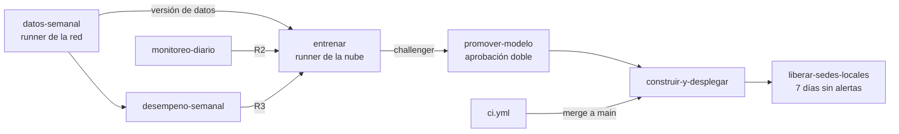

# 11. Orquestación e infraestructura

[Inicio](../README.md) · [Anterior: Seguridad, gobierno y ética](10-seguridad-gobierno-y-etica.md)

## 1. Objetivo

Definir **dónde corre cada pieza** del pipeline, **cómo se encadenan** las etapas sin intervención manual, **cómo se crea la infraestructura** de forma reproducible y **cuándo** conviene pasar a herramientas más grandes.

La etapa es transversal porque todas las demás dependen de ella: el *runner* de la red de [01. Datos](01-datos.md), la máquina de entrenamiento de [03. Entrenamiento](03-entrenamiento.md), el servidor de MLflow de [05. Registro y aprobación](05-registro-y-aprobacion.md), las máquinas del servicio de [07. Despliegue](07-despliegue.md) y los trabajos programados de [08. Monitoreo](08-monitoreo.md) y [09. Retroalimentación y reentrenamiento](09-retroalimentacion-y-reentrenamiento.md).

## 2. Entradas y salidas

| Entrada | Formato | Origen |
|---|---|---|
| Requisitos de cada etapa | Documentos `01` a `10` | Esta propuesta |
| Definición de la infraestructura | Archivos de Terraform en el repositorio | Equipo de ML |
| Definición de los flujos | Archivos YAML en `.github/workflows/` | Equipo de ML |

| Salida | Formato | Quién la consume |
|---|---|---|
| Infraestructura creada | Red, máquinas, bases, almacenamiento y bóveda en la nube | Todas las etapas |
| Flujos programados y por evento | Ejecuciones de GitHub Actions | Todas las etapas |
| Copias de seguridad | Respaldos de bases y versiones de objetos | Recuperación ante fallas |

## 3. Proceso

### 3.1 Dónde corre cada pieza

| Lugar | Componente | Tamaño de referencia | Etapas |
|---|---|---|---|
| **Servidor de la red** | *Runner* propio de GitHub Actions y contenedor de la etapa de datos; bóveda de secretos | El servidor existente de la red | 01 |
| **Nube: plataforma de ML** | Servidor de MLflow (seguimiento y registro), Prometheus, Grafana y *runner* propio de la nube | Máquina de 4 vCPU y 16 GB | 03, 05, 08, 09 |
| **Nube: entrenamiento** | Contenedor de entrenamiento | Máquina de 16 vCPU y 64 GB, **encendida solo mientras entrena** | 02, 03, 04 |
| **Nube: producción** | Docker Compose con Caddy, oauth2-proxy, API e interfaz | Máquina de 4 vCPU y 16 GB | 07 |
| **Nube: staging** | La misma composición que producción, sin médicos | Máquina de 2 vCPU y 8 GB | 06 |
| **Nube: servicios administrados** | PostgreSQL (predicciones, correcciones y metadatos de MLflow), almacenamiento de objetos compatible con S3 (DVC, artefactos de MLflow, reportes, respaldos) y bóveda de secretos | Según uso | Todas |
| **GitHub** | Repositorio, ramas protegidas, Actions, *environments* y GitHub Container Registry | | 06, 05 |
| **Sedes rurales** | Docker Desktop con el servicio en modo local | PC del consultorio (G5) | 07 |

**Proveedor de nube.** Se elige **Oracle Cloud Infrastructure, región Colombia Central (Bogotá)**, disponible desde noviembre de 2023 con el identificador `sa-bogota-1` ([notas de versión de Oracle](https://docs.oracle.com/iaas/releasenotes/changes/d332ad8f-ad0b-48f8-8577-33da7766ee36)). El criterio principal es que los datos queden **en Colombia** ([10. Seguridad, gobierno y ética](10-seguridad-gobierno-y-etica.md)), aunque lo que llega a la nube esté anonimizado. Como todo corre en contenedores, usa almacenamiento compatible con S3 y se crea con Terraform, cambiar de proveedor es posible sin rediseñar el pipeline (ver S11.1).

### 3.2 Cómo se encadenan las etapas

GitHub Actions es el orquestador. Cada flujo declara en qué *runner* corre: los de GitHub para lo que no toca datos, el de la red para datos identificables y el de la nube para lo que necesita la plataforma de ML.

| Flujo | Disparo | *Runner* | Qué hace | Etapa |
|---|---|---|---|---|
| `ci.yml` | Cada PR | GitHub | Lint, tipos, pruebas, paridad, contratos, casos de referencia, Trivy | 06 |
| `datos-semanal` | Domingo de madrugada | Red | Exportación FHIR, anonimización, validación, DVC; al terminar avisa a `entrenar` y a `desempeno-semanal` | 01 |
| `entrenar` | Disparadores R1 a R6 (programado, manual o evento) | Nube | Enciende la máquina de entrenamiento, ejecuta 02 a 04, registra en MLflow y la apaga | 02, 03, 04 |
| `promover-modelo` | Manual, con aprobación del *environment* `produccion` | Nube | Mueve alias en el registro y llama a `construir-y-desplegar` | 05 |
| `construir-y-desplegar` | Merge a `main` o llamado por `promover-modelo` | GitHub y nube | Construye imágenes, publica en GHCR, despliega en staging y producción | 06, 07 |
| `liberar-sedes-locales` | Diario | Nube | Si la versión remota lleva 7 días sin alertas, mueve la etiqueta `estable` | 09 |
| `monitoreo-diario` | Cada noche | Nube | Reportes de deriva con Evidently y alertas | 08 |
| `desempeno-semanal` | Al terminar `datos-semanal` | Nube | Une etiquetas con predicciones y calcula métricas | 08 |

Los *runners* propios se conectan **hacia afuera** con GitHub para recibir trabajos, así que el servidor de la red **no abre ningún puerto** hacia internet.

### 3.3 Infraestructura como código

Toda la infraestructura de la nube (red virtual, máquinas, base de datos, almacenamiento, bóveda y reglas de acceso) se describe con **Terraform** en el repositorio. Consecuencias:

- Staging y producción se crean con el mismo código, cambiando solo los tamaños; así staging es de verdad igual a producción.
- Cada cambio de infraestructura pasa por PR, como el código.
- Si una máquina se pierde, se recrea con un solo comando.

El estado de Terraform se guarda en el almacenamiento de objetos, cifrado y con versiones. La configuración dentro de cada máquina (Docker, Compose, *runner*) se aplica con *cloud-init* al crearla.

### 3.4 Copias de seguridad y recuperación

| Qué | Cómo | Retención |
|---|---|---|
| PostgreSQL (predicciones, correcciones, MLflow) | Respaldo diario automático del servicio administrado | 30 días |
| Almacenamiento de objetos (datos, artefactos, reportes) | Versiones de objetos activadas | 90 días para versiones anteriores |
| Repositorio, flujos e imágenes | GitHub | Permanente |
| Máquinas | No se respaldan: se recrean con Terraform y *cloud-init* | |

Objetivos: pérdida máxima de 24 horas de datos y recuperación del servicio remoto en menos de 4 horas; mientras tanto, las sedes pueden usar la instalación local de respaldo ([07. Despliegue](07-despliegue.md)). La restauración se prueba una vez por trimestre en staging.

### 3.5 Costo y operación

El costo se concentra en tres elementos: la máquina de producción, la base de datos administrada y la plataforma de ML, que corren todo el mes. La máquina de entrenamiento se paga **solo por las horas de uso** (unas pocas horas al mes) y el flujo `entrenar` la apaga al terminar, aunque falle. El cálculo exacto se hace con la calculadora del proveedor al implementar. GitHub Actions no agrega costo en repositorios públicos ni con *runners* propios.

Para el equipo de 3 personas (G6), la operación diaria se reduce a revisar tableros y alertas; actualizar sistemas operativos y dependencias se hace con Dependabot y con la recreación de máquinas desde Terraform.

### 3.6 Lo que no se usa al inicio, y cuándo sí

| Herramienta | Por qué no ahora | Cuándo sí |
|---|---|---|
| **Spark** | Cinco años de consultas de la red son unos pocos millones de filas, que caben en Parquet en una sola máquina y se procesan con pandas y PyArrow. El ejemplo de la Fintech lo necesita porque procesa millones de archivos al día en 30 minutos; aquí la predicción es una consulta a la vez | Si el volumen pasa de cientos de millones de filas o se agregan otras redes con procesamiento por lotes diario |
| **Kubernetes** | Un solo servicio en una máquina con Docker Compose atiende 2.000 consultas al día (G10); Kubernetes exigiría operar un clúster | Si el servicio necesita escalar automáticamente en varias máquinas o alta disponibilidad entre zonas |
| **Airflow o Prefect** | Hay ocho flujos con dependencias simples, y GitHub Actions ya los orquesta con historial y aprobaciones, sin servidores adicionales | Si los flujos pasan de unos 15, con dependencias complejas, reprocesos históricos o varios equipos. Prefect sería la primera opción por ser más liviano de operar |
| ***Feature store*** (Feast) | Las características salen de la propia consulta ([02. Características](02-caracteristicas.md)) | Si el modelo empieza a usar la historia del paciente en el momento de predecir |

Pasar a cualquiera de estas herramientas es el camino del nivel 1 al nivel 2 de madurez ([00. Contexto y supuestos](00-contexto-y-supuestos.md)) cuando el tamaño lo justifique.

## 4. Tecnologías

| Necesidad | Tecnología elegida | Alternativas consideradas | Por qué sí y por qué no | Costo y operación |
|---|---|---|---|---|
| Nube | **Oracle Cloud Infrastructure**, región Bogotá | Otros proveedores con región fuera de Colombia; solo servidor propio de la red | Cumple el criterio de datos en Colombia. Un proveedor con región en otro país exigiría revisar la transferencia internacional; usar solo el servidor de la red cargaría a TI con toda la operación (G11) | Pago por uso; ver 3.5 |
| Orquestación | **GitHub Actions** con *runners* propios en la red y en la nube | Airflow; Prefect; cron | Ya es la herramienta del equipo (Unidad 2), no necesita servidores y deja historial y aprobaciones. Ver 3.6 para cuándo cambiar | Sin costo adicional en repositorio público y con *runners* propios |
| Infraestructura como código | **Terraform** | Crear recursos a mano en la consola; Pulumi | Terraform tiene proveedor para Oracle Cloud y para los demás proveedores, y su código se revisa por PR. A mano no es reproducible; Pulumi es equivalente pero menos conocido por el equipo | Sin licencias |
| Ejecutar servicios | **Docker Compose** | Kubernetes | Ver 3.6 | Sin licencias |
| Almacenamiento de datos y artefactos | **Almacenamiento de objetos compatible con S3** | Disco compartido (NFS) | DVC y MLflow lo usan de forma nativa, tiene versiones y es barato | Pago por GB |
| Configuración de máquinas | ***cloud-init*** | Ansible | Basta para instalar Docker y levantar Compose al crear la máquina; Ansible se justifica con muchas máquinas | Sin costo |

## 5. Suposiciones

| # | Suposición | Implicación si deja de cumplirse |
|---|---|---|
| S11.1 | La región de Bogotá ofrece los servicios administrados necesarios (PostgreSQL, almacenamiento de objetos compatible con S3, bóveda) | Si alguno no está disponible en la región, se ejecuta en contenedor en la plataforma de ML (por ejemplo, PostgreSQL con respaldos propios) o se compara otro proveedor con el mismo criterio de ubicación |
| S11.2 | El servidor de la red tiene salida a internet por HTTPS para el *runner* | Sin salida, la etapa de datos se ejecuta con un trabajo programado local y la publicación de DVC se hace por un canal aprobado por TI |
| S11.3 | El equipo puede mantener Terraform | Si no, la infraestructura se crea a mano una vez con un procedimiento documentado, perdiendo la recreación automática |
| S11.4 | Las máquinas de referencia alcanzan para el volumen del escenario (G10) | Si no, se aumenta el tamaño en Terraform; la arquitectura no cambia |
| S11.5 | El repositorio del sistema es público o tiene un plan que permite *environments* con revisores (S05.2) | Ver la alternativa con CODEOWNERS en [05. Registro y aprobación](05-registro-y-aprobacion.md) |

## 6. Enfermedades comunes y huérfanas

| Aspecto | Comunes (muchos datos) | Huérfanas (pocos datos) |
|---|---|---|
| Cómputo | Entrenamiento completo en la máquina de entrenamiento, que se enciende y se apaga | La rama de huérfanas es liviana: los reentrenamientos por R4 corren en la plataforma de ML sin encender la máquina grande |
| Frecuencia | Mensual o por deriva | Cada vez que llega un caso confirmado nuevo |

## 7. Criterios de salida y controles de calidad

- `terraform plan` sin cambios pendientes sobre la infraestructura real (no hay recursos creados a mano).
- Staging y producción creados con el mismo código.
- Todos los flujos de la tabla 3.2 existen, tienen dueño y registran sus ejecuciones.
- Prueba trimestral de restauración superada.
- La máquina de entrenamiento está apagada cuando no hay un flujo `entrenar` en curso.

## 8. Riesgos

| Riesgo | Mitigación |
|---|---|
| Dependencia del proveedor de nube | Contenedores, almacenamiento con interfaz S3 y Terraform permiten migrar |
| *Runner* de la red comprometido | Solo ejecuta flujos de ramas protegidas, con un usuario sin privilegios y acceso de solo lectura a la historia clínica |
| Costos inesperados por máquinas encendidas | Apagado automático al terminar `entrenar`, incluso si falla, y alerta de presupuesto en el proveedor |
| Falla de la máquina de producción | Reinicio automático, recreación con Terraform e instalación local de respaldo en las sedes |

## 9. Cambios respecto a la propuesta original

| Antes (propuesta original) | Ahora | Motivo |
|---|---|---|
| No había orquestación: no se decía cómo se encadenan ni se programan las etapas | Ocho flujos de GitHub Actions con disparos, *runners* y dependencias definidos | Un pipeline sin orquestación no se ejecuta solo |
| No había infraestructura ni proveedor | Mapa de dónde corre cada pieza, Oracle Cloud en Bogotá y Terraform | La restricción de despliegue local o en la nube exige decir dónde |
| Sin copias de seguridad ni recuperación | Respaldos, versiones de objetos y objetivos de recuperación | Continuidad del servicio clínico |
| No se discutían herramientas de gran escala | Criterio explícito de cuándo usar Spark, Kubernetes, Airflow o un *feature store* | Mostrar que el tamaño del stack responde al escenario, no a la moda |
